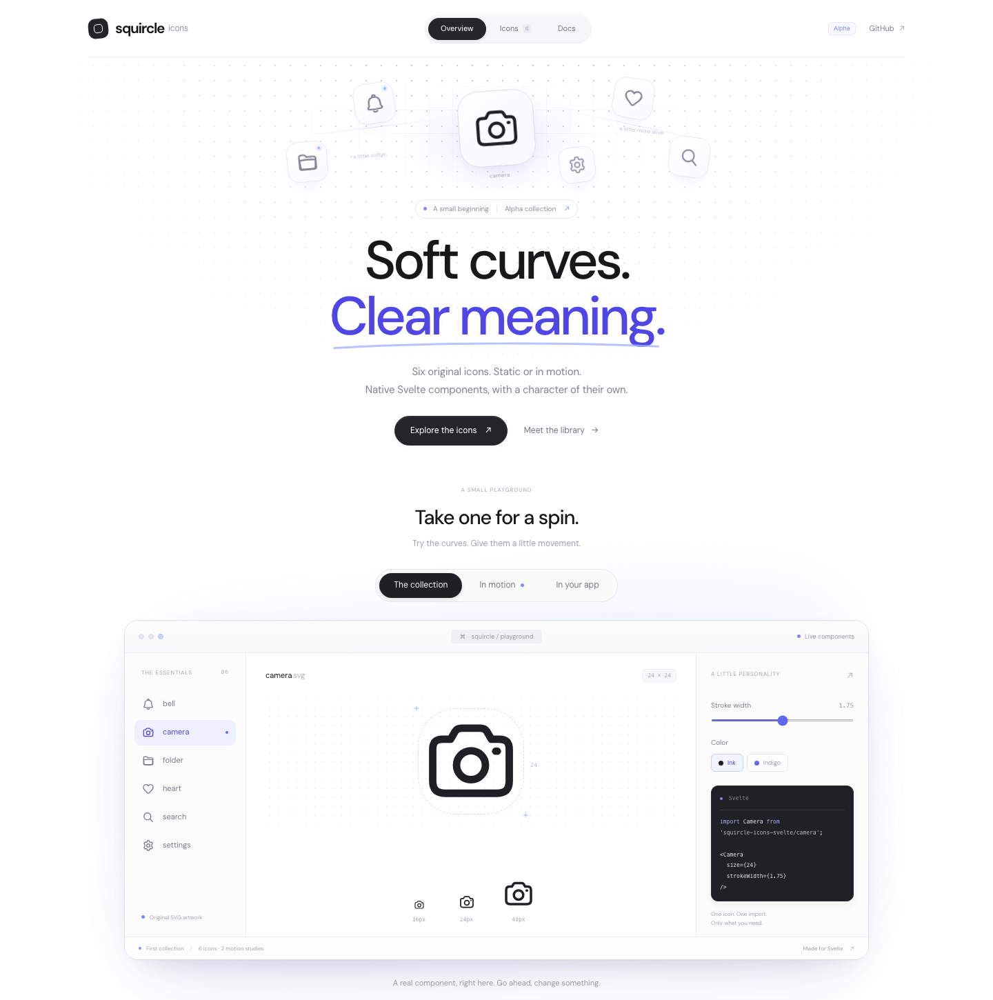
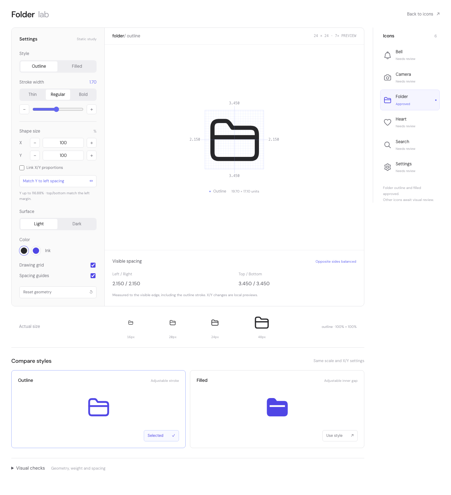

# Squircle Icons · Homepage

**Alpha stage · Open source · MIT license**

The SvelteKit website for Squircle Icons: a white/black/indigo landing page, icon gallery, and documentation. It consumes the real packed [Svelte adapter](https://github.com/squircle-icons/svelte); artwork and recipes live in [core](https://github.com/squircle-icons/core).



## Develop

Use Node.js 24.19.0 and pnpm 10.10.0.

```sh
pnpm install --frozen-lockfile
pnpm dev
```

Routes: `/` landing and interactive playground, `/icons` gallery and motion studies, `/docs` installation/API/accessibility guide, and `/lab` the icon review workbench. The generated catalog is derived from the installed package metadata, while components are imported through the package's actual exports. There is no duplicate icon implementation in this repository.

## Verify

```sh
pnpm exec playwright install chromium firefox webkit
pnpm verify
pnpm preview
```

Checks cover the pinned dependency's commit/hash, catalog generation, Svelte/TypeScript diagnostics, production prerender, navigation, controls, playground/motion interactions, and 390/700-pixel layouts across Chromium, Firefox, and WebKit. Adapter-specific SSR/motion/bundle/tarball checks live in the Svelte repository; source/model tests live in core.

## Update the package

```sh
pnpm sync:svelte ../svelte
```

The committed, clean Svelte checkout is checked and built, then packed into `vendor/`. The command records its commit and SHA-256, refreshes the package/lockfile, and regenerates catalog imports. Commit the artifact, provenance, generated catalog, and lockfile together. CI only needs this repository and the public development dependencies; it does not need cross-repository tokens.

The included tarball is a reviewed alpha artifact, not an npm release. Original artwork and code are licensed under [MIT](LICENSE); third-party assets retain their own licenses. No website deployment is performed by CI. See [migration provenance](MIGRATION.md), [design notes](design/DESIGN.md), and [third-party notices](THIRD_PARTY_NOTICES.md).

## Icon lab

Open the desktop-only `/lab` workspace for static icon review. It has no site app bar or footer. Select icons in the right sidebar and compare real Outline and Filled Folder exports. Thin (1.25), Regular / default (1.70), and Bold (2.25) presets retain fine adjustment. Folder is approved in both styles; other icons await review. You can resize the source geometry on X/Y independently or with linked proportions, and inspect measured opposite margins on the 24×24 grid. Preview scaling stays centered and preserves the chosen Outline stroke weight. Light/dark surfaces, ink/indigo colors and 16/20/24/48px samples support optical review.

Y is limited by the current left margin, with a “Match Y to left spacing” button for exact matching. X is limited by measured artwork and available grid space, including stroke. X/Y values are percentages of source geometry (100% is the original, including the approved Folder proportions); they are local previews, not saved artwork edits. Filled Folder is separately authored fill-only geometry with a negative-space divider controlled by stroke width; the outside remains fixed. Other filled icons are not implemented yet. Motion development is paused and motion controls have been removed from the Lab. See [lab review notes](design/LAB.md).


